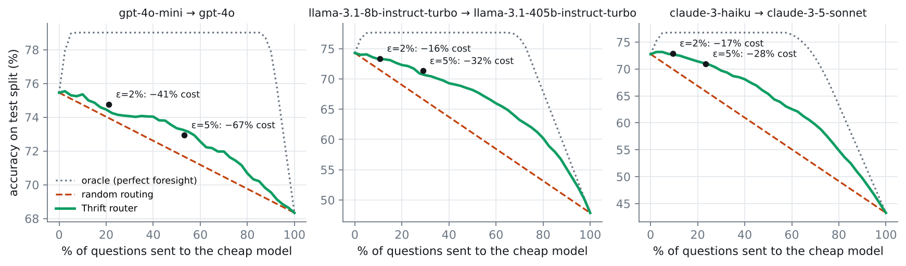

# Thrift: same answers, fewer tokens

**An OpenAI-compatible LLM gateway that cuts token spend with three mechanisms (a
semantic cache, query-aware prompt compression and difficulty-based model routing) and
puts a statistical guarantee on how much quality each one is allowed to cost.**

[](.github/workflows/ci.yml)
[Paper (PDF)](docs/paper/thrift.pdf) · [Results](results/) · [Benchmarks](#reproduce-every-number)

Point any OpenAI SDK at Thrift and change nothing else. Every number below comes from a
real run in this repo, on real model outputs, with no API key needed to reproduce it.

| Mechanism | Measured on | Result |
|---|---|---|
| **Routing** | 8,021 HELM Lite questions, real GPT-4o-mini and GPT-4o answers | **41% lower bill** for a **0.7-point** accuracy drop, certified at ≤ 2 points |
| **Semantic cache** | Quora Question Pairs (adversarial near-duplicates) | **6x more cache hits** than exact matching, wrong answers certified ≤ 2% |
| **Compression** | Natural Questions with 10 retrieved passages, real BERT reader | keeps **97.6%** of reader F1 at **25%** of the context (truncation keeps 27%) |
| **Overhead** | in-process, mock upstream | **1.3 ms** p50 added per request; cache hits 0.08 ms |



---

## Why this exists

Teams overpay for LLM calls in three predictable ways: they send every question to their
biggest model, they pay again for questions they have already answered, and they ship
padded prompts full of context the model never needed. Each fix is well known. What
stops teams from turning them on is fear of the quality hit: a router or a cache that is
wrong 5% of the time is worse than no router at all.

Thrift's answer is to make every quality/cost knob **certified**. Each knob is set by
[Learn then Test](https://arxiv.org/abs/2110.01052) (Angelopoulos, Bates, Candès et al.)
on held-out data, which guarantees:

> with probability at least 1 − δ, the expected quality loss on new traffic is at most ε,

with no assumptions about the model, the scorer or the data distribution beyond
exchangeability. A weak scorer does not break the guarantee; it just saves less. This is
the same family of distribution-free guarantees that
[Pacer](https://github.com/parveen06naresh/pacer-serve) uses for latency SLOs, applied here
to quality.

## Quickstart

```bash
pip install -e ".[tiktoken]"          # Python 3.10+
thrift-llm demo                       # offline: mock models, replayed traffic, live dashboard
```

With real models:

```bash
thrift-llm init                       # writes thrift.toml (tiers: cheapest first, strongest last)
export OPENAI_API_KEY=...
thrift-llm serve --config thrift.toml # http://127.0.0.1:8787/v1, dashboard at /dashboard
```

```python
from openai import OpenAI
client = OpenAI(base_url="http://127.0.0.1:8787/v1", api_key="unused")
client.chat.completions.create(model="thrift-auto", messages=[{"role": "user", "content": "..."}])
```

`model="thrift-auto"` lets Thrift route. A tier name (`"cheap"`, `"strong"`) or the
upstream model name pins the request and still gets caching and compression. Any
backend that speaks the OpenAI chat API works as a tier: OpenAI, Azure OpenAI, Anthropic's
OpenAI-compatible endpoint, Together, Groq, Fireworks, OpenRouter, and self-hosted vLLM,
SGLang, TGI, llama.cpp or Ollama.

Docker: `docker build -t thrift . && docker run -p 8787:8787 -v $PWD/thrift.toml:/app/thrift.toml -e OPENAI_API_KEY thrift`

## How it works

```
request ──► exact cache ──► semantic cache ──► compress ──► route ──► upstream ──► store
             (hash)          (cosine +          (normalize,   (difficulty   (retry,       (only complete
                              key-term guard,    dedup,        score ≥       fallback to   answers)
                              certified τ)       query-aware   certified λ)  strong tier)
                                                 selection)
```

| Piece | What it does | Guarantee / safety rule |
|---|---|---|
| **Exact cache** | SHA-256 of the scoped, normalised request | Scope = tier + system prompt + history + sampling params + tools, so a hit can only replace an identical call |
| **Semantic cache** | Nearest cached question in the same scope (hashed n-gram embedding, pluggable) | Threshold τ certified so P(wrong cached answer) ≤ α. Numbers and negations must match exactly ("5 km" ≠ "50 km", "safe" ≠ "not safe") |
| **Compression** | Lossless whitespace/markup normalisation, duplicate-paragraph removal, then BM25 sentence selection against the user's question for long context | Keep-ratio certified against a reader model; the question, system prompt, recent turns and code blocks are never cut |
| **Router** | Logistic scorer over hashed n-grams + structure features predicts "cheap model is good enough" | Threshold λ certified so E[accuracy(strong) − accuracy(routed)] ≤ ε |
| **Ledger** | Per-request cost vs. what the same request would have cost uncompressed on the strongest tier | Exposed as response headers, `/thrift/stats`, Prometheus `/metrics` and the dashboard |

Every response carries `x-thrift-tier`, `x-thrift-cache`, `x-thrift-prompt-tokens-original`,
`x-thrift-prompt-tokens-sent`, `x-thrift-cost-usd` and `x-thrift-baseline-usd`.
Per-request opt-outs: header `x-thrift-bypass: 1`, `x-thrift-cache: off`, or a body field
`"thrift": {"cache": false, "compress": 0.7, "route": false}` (stripped before forwarding).

**Production details:** streaming (SSE passthrough, cached answers replayed as streams),
retries with jittered backoff on 429/5xx, automatic fallback to the strong tier when the
cheap one fails, client API keys, SQLite persistence for cache and ledger, LRU + TTL
eviction, shadow sampling (`[shadow] rate`) that sends a slice of cheap-routed traffic to
the strong tier and logs both answers so you can re-certify the router on your own traffic.

## Results

### 1. Routing: real answers from three model families

HELM Lite publishes every prompt, every completion, token counts and the per-question
score for each model it evaluates. Thrift's router is trained, certified and tested on
those real outcomes (8,021 questions across MMLU, GSM8K, MATH, MedQA, LegalBench,
OpenBookQA, NaturalQuestions and NarrativeQA), so cost and accuracy are measured, not
simulated. Each row averages 40 random train/calibrate/test splits (50/25/25); cost uses
each model's real token counts at list prices ([pricing.py](thrift_llm/pricing.py)).

| Cheap → strong | ε (max drop) | Sent to cheap | Accuracy drop | Random routing, same share | Bill saved | Bound held |
|---|---|---|---|---|---|---|
| GPT-4o-mini → GPT-4o | 1 pt | 10% | 0.19 pts | 0.75 pts | **27%** | 95% of splits |
| | **2 pts** | **21%** | **0.69 pts** | 1.57 pts | **41%** | 97.5% |
| | 5 pts | 53% | 2.51 pts | 3.95 pts | **67%** | 90% |
| Llama-3.1-8B → 405B | 2 pts | 11% | 0.92 pts | 2.78 pts | 16% | 97.5% |
| | 5 pts | 29% | 2.95 pts | 7.51 pts | 32% | 95% |
| Claude-3-Haiku → 3.5-Sonnet | 2 pts | 9% | −0.14 pts | 2.76 pts | 17% | 95% |
| | 5 pts | 24% | 1.79 pts | 6.88 pts | 28% | 87.5% |

*"Bound held" = share of test splits where the certified quantity (the clipped quality
loss) stayed ≤ ε; the target is ≥ 90%. One cell (87.5%, 35 of 40 splits) is below target;
with 40 overlapping splits that is within sampling noise, and it is reported as measured.*

Reading the table: at a 2-point budget, routing cuts the GPT-4o bill by 41% while sending
only 21% of questions to GPT-4o-mini, because the router learns that long reading tasks
(the expensive prompts) are where the small model already matches the large one. Against
random routing at the same share, the router loses 2 to 5 times less accuracy.

### 2. Semantic cache: certified on the hardest public benchmark

Quora Question Pairs (404k human-labelled pairs) is built to fool caches: its
non-duplicates were chosen because they look alike. Workload: cache 10,000 questions, ask
10,000 paraphrase candidates, any cached entry may answer. Ten independent draws, with
calibration and test sets that share no questions.

| Setting | Served from cache | Wrong answers | Bound held |
|---|---|---|---|
| Exact match only | 1.2% | 0.04% (QQP label noise) | |
| Thrift, certified α = 1% | 4.8% | 0.74% | 10/10 |
| **Thrift, certified α = 2%** | **7.0%** | **1.73%** | 9/10 |
| Thrift, certified α = 5% | 12.1% | 4.62% | 9/10 |

Lookup takes 2.2 ms (p50) with 10k cached entries on one CPU core. The hit rate on your
traffic depends on how often users repeat themselves; the wrong-answer rate is what Thrift
controls. The key-term guard is what makes numbers like "convert 5 km" vs "convert 50 km"
safe (see [cache.py](thrift_llm/cache.py)).

### 3. Compression: does the answer survive?

Each of 240 Natural Questions items gets its gold passage plus 9 distractor passages,
shuffled (about 2031 tokens), like a retriever's top-10. A real BERT reader
(SQuAD fine-tuned, ONNX) answers from the full and the compressed context. Full-context F1 is 0.553.

| Context kept | Thrift (query-aware) | Truncate | Random sentences |
|---|---|---|---|
| 60% | **0.541** (98%) | 0.310 (56%) | 0.413 (75%) |
| 40% | **0.536** (97%) | 0.229 (42%) | 0.294 (53%) |
| 25% | **0.539** (98%) | 0.150 (27%) | 0.275 (50%) |

At a quarter of the tokens, Thrift keeps 97.6% of answer quality; cutting the end keeps
27%. Script: [scripts/eval_compress.py](scripts/eval_compress.py), raw numbers in
[results/compress.json](results/compress.json).

**Honest note on the guarantee.** With only 120 calibration questions, Learn-then-Test cannot
certify any compression at ε = 2 or 5 points, so the certified keep-ratio stays at 100% (it is
conservative, never wrong). Per-question answers flip in both directions, so the per-question loss is
6–8% even though average F1 barely moves. At ε = 10 points it certifies compression in
24% of splits with 2% violations (target ≤ 10%).
Certifying 25% context at a 5-point average bound needs roughly 3,500 labelled questions: collect them
with the shadow log and certify a keep-ratio with `thrift_llm.risk.learn_then_test`. Until then the shipped
default (keep 50% of messages over 500 tokens) is an empirical setting, not a certified one; set
`select = false` under `[compress]` to keep only the lossless stages.

The lossless normalisation stage alone removes 0.5% of tokens from HELM Lite prompts
(already clean text; scraped HTML and PDFs carry much more whitespace).

### 4. Overhead

Measured with zero-latency mock upstreams so all time is Thrift's own (4-core cloud VM, Python 3.13.16):

| Path | p50 | p99 |
|---|---|---|
| Cache miss, short prompt (route + cache lookup + ledger) | 1.3 ms | 5.2 ms |
| Cache hit | 0.08 ms | 1.3 ms |
| Long context compressed (~2k tokens) | 21 ms | 70 ms |
| Semantic lookup, 1k / 10k / 50k entries | 0.4 / 3.1 / 11.7 ms | |

Over HTTP, one uvicorn worker served 211 requests/s at concurrency 32 (p50 105 ms, which is queueing,
with the load generator on the same 4 cores). LLM calls take 300–3,000 ms, so in-process overhead is
under 1% of a typical request. For more throughput run several workers behind a load balancer; the
exact-match layer and ledger are per process unless you point `cache.path` at shared storage. Script:
[scripts/bench_overhead.py](scripts/bench_overhead.py).

## Calibrate on your own traffic

The bundled router is certified on HELM-style questions. For your workload, collect
prompts where you know how good each model's answer was (an offline eval, an LLM judge,
user feedback, or Thrift's own shadow log) as JSONL rows
`{"prompt": ..., "q_cheap": 0..1, "q_strong": 0..1}`, then:

```bash
thrift-llm calibrate --data labelled.jsonl --epsilon 0.02 --delta 0.1 --out router.json
# prints the certified threshold, the share of traffic it sends to the cheap model, and the bound
```

and set `[router] path = "router.json"`. The same procedure is exposed for the cache
(`thrift_llm.cache.calibrate_threshold`) and the compressor (`thrift_llm.risk.learn_then_test`).

## Reproduce every number

```bash
pip install -e ".[dev,eval]"
python scripts/fetch_helm.py        # HELM Lite per-question results (public GCS bucket)
python scripts/eval_router.py       # results/router.json, ships thrift_llm/data/router_helm.json
python scripts/eval_cache.py        # downloads QQP, results/cache.json
python scripts/eval_compress.py     # downloads the ONNX BERT reader, results/compress.json
python scripts/bench_overhead.py    # results/overhead.json
python scripts/make_figures.py      # docs/figures/*.png
pytest -q                           # 31 tests
```

## Honest limitations

* **Routing quality depends on the scorer.** The bundled logistic router is small (AUC
  0.56 to 0.73 depending on the model pair). The guarantee holds regardless; a stronger
  scorer (an embedding model, a fine-tuned classifier) would route more traffic at the same
  ε. Savings are larger when the cheap model is closer to the strong one.
* **Guarantees are about averages over exchangeable traffic.** If your traffic shifts
  (new product, new users), re-certify. Shadow sampling exists for exactly this.
* **The default cache embedding is lexical.** It catches rephrasings, not synonyms. A
  learned embedding plugs in through `SemanticCache(embedder=...)` and gets certified the
  same way. QQP is adversarial, so hit rates on ordinary traffic with real repetition are
  typically higher; this repo does not claim a number for traffic it has not measured.
* **Compression is measured with an extractive reader, not a frontier LLM.** BERT-base is
  a real model whose answers break when evidence is cut, which is what the benchmark needs,
  but a stronger LLM may be more (or less) robust to compressed context.
* **Prices are list prices** at the time of writing; override them in config.

## Project layout

```
thrift_llm/      gateway.py (pipeline) · server.py (HTTP) · router.py · cache.py · compress.py
                 risk.py (Learn-then-Test) · ledger.py · backends.py · pricing.py · cli.py
                 dashboard.html · data/router_helm.json (bundled certified router)
scripts/         fetch_helm.py · eval_router.py · eval_cache.py · eval_compress.py · reader.py
                 bench_overhead.py · make_figures.py · build_paper.py
results/         raw JSON for every number in this README
docs/            paper (HTML + PDF) and figures
tests/           31 tests: risk math, cache, compression, router, HTTP server end to end
```

## Data and acknowledgements

Routing data: [HELM Lite](https://crfm.stanford.edu/helm/lite/) v1.13.0 (Stanford CRFM),
whose per-instance results are public. Cache data:
[Quora Question Pairs](https://quoradata.quora.com/First-Quora-Dataset-Release-Question-Pairs).
Reader: `bertsquad-12` from the [ONNX Model Zoo](https://github.com/onnx/models)
(Apache-2.0). Tokenizer: OpenAI `tiktoken` `o200k_base`. Built with AI-assisted development
(Claude Code).

## License

MIT. Author: Parveen Kumar Naresh Kumar.
