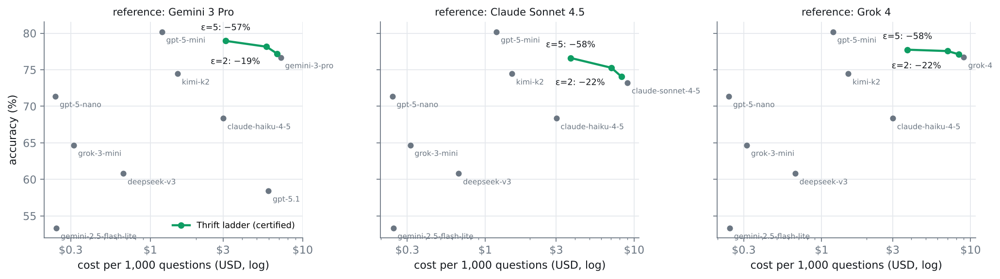

<div align="center">

# Thrift

### Same answers. Fewer tokens.

**One endpoint for Claude, GPT, Gemini, Grok, Perplexity, DeepSeek, Kimi and Mistral that sends
every request to the cheapest model that can answer it, and *proves* how much quality that costs.**

[](.github/workflows/ci.yml)


[](docs/paper/thrift.pdf)

</div>

```python
# pip install "thrift-llm[tiktoken] @ git+https://github.com/parveen06naresh/thrift"
from thrift_llm import Thrift
client = Thrift("openai:gpt-5-mini", "anthropic:claude-opus-5-5")   # cheapest first, strongest last
r = client.chat.completions.create(model="thrift-auto", messages=[{"role": "user", "content": "Why is the sky blue?"}])
print(r.choices[0].message.content, r.thrift["x-thrift-tier"], r.thrift["x-thrift-cost-usd"])
```

Same call shape as the OpenAI SDK, in-process, no server. Or run it as a proxy and point any
OpenAI client, LangChain or LlamaIndex app at it: `thrift-llm serve --tier openai:gpt-5-mini --tier anthropic:claude-opus-5-5`.

## What it does to your bill

Measured on the newest public per-question results (Stanford HELM Capabilities, Nov 2025: GPQA,
MMLU-Pro, Omni-MATH, IFEval), with real answers from 11 frontier models by 6 vendors:

| If your app runs on | Thrift's bill | Accuracy | Quality promise (certified) |
|---|---|---|---|
| **Gemini 3 Pro** | **−57%** | +2.3 pts | loses ≤ 5 pts, P ≥ 90% |
| **Claude Sonnet 4.5** | **−58%** | +3.4 pts | loses ≤ 5 pts, P ≥ 90% |
| **Grok 4** | **−58%** | +1.0 pts | loses ≤ 5 pts, P ≥ 90% |
| Gemini 3 Pro / Claude Sonnet 4.5 / Grok 4, stricter | −19% / −22% / −22% | +1.5 / +2.0 / +0.8 pts | loses ≤ 2 pts |

Accuracy went *up* because, question by question, another vendor's cheaper model is often the
better one. Costs charge every model the same tokens at its list price (reasoning models' hidden
thinking tokens are not counted; see [Honest limitations](#honest-limitations)).

| Also measured | Result |
|---|---|
| 8,021 HELM Lite questions, 7 models by 5 vendors | **46% below GPT-4o** at the same accuracy |
| Drift guard: a provider silently downgrades two models | caught in **99%** of streams, 1 false alarm in 900 |
| Semantic cache on Quora Question Pairs | **6x** the hits of exact matching, wrong answers ≤ 2% (certified) |
| Compression on 10-passage RAG prompts, real reader | **97.6%** of answer quality at **25%** of the tokens |
| Overhead | **1.3 ms** per request (p50) |



### How it compares

| | Thrift | LiteLLM | RouteLLM | GPTCache |
|---|---|---|---|---|
| One API for many providers | ✓ (14 presets, native Claude) | ✓ (100+) | | |
| Routes each request by difficulty | ✓ across N models | | ✓ two models | |
| Semantic cache | ✓ with key-term guard | ✓ | | ✓ |
| Prompt compression | ✓ | | | |
| **Statistical quality guarantee** | **✓ for every knob** | | | |
| **Live drift detection** | **✓ anytime-valid** | | | |
| Cost ledger, dashboard, Prometheus | ✓ | ✓ | | |

LiteLLM is the broader proxy (more providers, budgets, teams). Thrift is narrower and stricter:
its job is to cut the bill without letting quality slip unnoticed, and it can sit behind or in
front of LiteLLM.

---

## Why this exists

Teams overpay for LLM calls in three predictable ways: they send every question to their
biggest model, they pay again for questions they have already answered, and they ship
padded prompts full of context the model never needed. Each fix is well known. What
stops teams from turning them on is fear of the quality hit: a router or a cache that is
wrong 5% of the time is worse than no router at all.

Thrift's answer is to make every quality/cost knob **certified**. Each knob is set by
[Learn then Test](https://arxiv.org/abs/2110.01052) (Angelopoulos, Bates, Candès et al.)
on held-out data, which guarantees:

> with probability at least 1 − δ, the expected quality loss on new traffic is at most ε,

with no assumptions about the model, the scorer or the data distribution beyond
exchangeability. A weak scorer does not break the guarantee; it just saves less. This is
the same family of distribution-free guarantees that
[Pacer](https://github.com/parveen06naresh/pacer-serve) uses for latency SLOs, applied here
to quality.

## Quickstart

```bash
pip install "thrift-llm[tiktoken] @ git+https://github.com/parveen06naresh/thrift"   # Python 3.10+, not on PyPI yet
thrift-llm demo                       # offline: mock models, replayed traffic, live dashboard
thrift-llm models anthropic           # the model IDs a provider serves today, with known prices
```

With real models:

```bash
thrift-llm init                       # writes thrift.toml (tiers: cheapest first, strongest last)
export OPENAI_API_KEY=...
thrift-llm serve --config thrift.toml # http://127.0.0.1:8787/v1, dashboard at /dashboard
```

```python
from openai import OpenAI
client = OpenAI(base_url="http://127.0.0.1:8787/v1", api_key="unused")
client.chat.completions.create(model="thrift-auto", messages=[{"role": "user", "content": "..."}])
```

`model="thrift-auto"` lets Thrift route. A tier name (`"cheap"`, `"strong"`, `"grok"`) or the
upstream model name pins the request and still gets caching and compression.

### Every provider, one endpoint

Set `provider` on a tier and Thrift fills in the endpoint and the usual key variable:

| `provider` | Service | Key variable | Notes |
|---|---|---|---|
| `openai` (`chatgpt`) | OpenAI | `OPENAI_API_KEY` | automatic prompt caching is priced in the ledger |
| `anthropic` (`claude`) | Anthropic Claude | `ANTHROPIC_API_KEY` | **native Messages API**: Thrift marks long system prompts and chat history cacheable, so repeat reads cost 10% |
| `xai` (`grok`) | xAI Grok | `XAI_API_KEY` | |
| `perplexity` (`sonar`) | Perplexity | `PERPLEXITY_API_KEY` | answers come from live web search, so they are **never cached** |
| `gemini` (`google`) | Google Gemini | `GEMINI_API_KEY` | OpenAI-compatible endpoint |
| `deepseek`, `mistral`, `groq`, `together`, `fireworks`, `openrouter` | | `<NAME>_API_KEY` | |
| `ollama`, `vllm` | self-hosted | none | set `base_url` for SGLang, TGI, llama.cpp |

Clients keep sending OpenAI-format requests, including tools, images and streaming; the Claude
adapter translates both ways. Each tier can name a `fallback` list (e.g. Grok, then Gemini,
then GPT-4o) that is tried in order when a provider errors. A five-vendor config with the
certified ladder is in [examples/multi_provider.toml](examples/multi_provider.toml).

Docker: `docker build -t thrift . && docker run -p 8787:8787 -v $PWD/thrift.toml:/app/thrift.toml -e OPENAI_API_KEY thrift`

## How it works

```
request ──► exact cache ──► semantic cache ──► compress ──► route ──► upstream ──► store
             (hash)          (cosine +          (normalize,   (difficulty   (retry,       (only complete
                              key-term guard,    dedup,        score ≥       fallback to   answers)
                              certified τ)       query-aware   certified λ)  strong tier)
                                                 selection)
```

| Piece | What it does | Guarantee / safety rule |
|---|---|---|
| **Exact cache** | SHA-256 of the scoped, normalised request | Scope = tier + system prompt + history + sampling params + tools, so a hit can only replace an identical call |
| **Semantic cache** | Nearest cached question in the same scope (hashed n-gram embedding, pluggable) | Threshold τ certified so P(wrong cached answer) ≤ α. Numbers and negations must match exactly ("5 km" ≠ "50 km", "safe" ≠ "not safe") |
| **Compression** | Lossless whitespace/markup normalisation, duplicate-paragraph removal, then BM25 sentence selection against the user's question for long context | Keep-ratio certified against a reader model; the question, system prompt, recent turns and code blocks are never cut |
| **Router** | Logistic scorer over hashed n-grams + structure features predicts "cheap model is good enough" | Threshold λ certified so E[accuracy(strong) − accuracy(routed)] ≤ ε |
| **Ladder** | Same scorer, one per cheaper model, across providers; each request goes to the cheapest model predicted to match the strongest | One threshold certified so E[accuracy(strongest) − accuracy(chosen)] ≤ ε |
| **Drift guard** | Shadow-samples cheaper-routed traffic, judges it, runs an anytime-valid e-process | P(false alarm, ever) ≤ α; on alarm everything goes to the strongest tier |
| **Ledger** | Per-request cost vs. what the same request would have cost uncompressed on the strongest tier | Exposed as response headers, `/thrift/stats`, Prometheus `/metrics` and the dashboard |

Every response carries `x-thrift-tier`, `x-thrift-cache`, `x-thrift-prompt-tokens-original`,
`x-thrift-prompt-tokens-sent`, `x-thrift-cost-usd` and `x-thrift-baseline-usd`.
Per-request opt-outs: header `x-thrift-bypass: 1`, `x-thrift-cache: off`, or a body field
`"thrift": {"cache": false, "compress": 0.7, "route": false}` (stripped before forwarding).

**Production details:** streaming (SSE passthrough, cached answers replayed as streams),
retries with jittered backoff on 429/5xx/529, per-tier fallback chains across providers,
client API keys, SQLite persistence for cache and ledger, LRU + TTL eviction, Prometheus
metrics, and shadow sampling (`[shadow] rate`) that sends a slice of cheaper-routed traffic
to the strongest tier, logs both answers for re-certification, and feeds the drift guard.

### Drift guard

A certificate is only as good as the assumption that tomorrow's traffic looks like the
calibration data. Providers update models without notice, and products change. Thrift keeps
testing the claim while it serves: a fraction `r` of requests sent to a cheaper model is also
answered by the strongest tier, a judge (the strongest model by default, or token overlap)
scores how much worse the cheap answer was, and every routed request feeds a betting
e-process for "live risk ≤ ε". By Ville's inequality the chance of a false alarm over the
whole, unbounded stream is at most α (default 5%). When it fires, Thrift enters **safe mode**
(all auto-routed traffic to the strongest tier, `x-thrift-safe-mode: 1`, dashboard and
`/metrics` flag it) until you re-certify and `POST /thrift/drift/reset`.

## Results

### 1. Frontier models (2025 generation): GPT-5.1, Gemini 3 Pro, Grok 4, Claude 4.5

[HELM Capabilities v1.15.0](https://crfm.stanford.edu/helm/capabilities/) (Stanford CRFM, Nov 2025) is
the newest public release with every prompt, answer and score per model. Thrift's ladder is
trained, certified and tested on 2,987 of those questions (GPQA 446, MMLU-Pro
1000, Omni-MATH 1000, IFEval 541), 20 random 50/25/25 splits. Script:
[scripts/eval_frontier.py](scripts/eval_frontier.py).

| Model | Accuracy | Cost per 1,000 questions* |
|---|---|---|
| gpt-5-nano | 71.4% | $0.24 |
| gemini-2.5-flash-lite | 53.3% | $0.24 |
| grok-3-mini | 64.7% | $0.31 |
| deepseek-v3 | 60.8% | $0.66 |
| gpt-5-mini | 80.2% | $1.19 |
| kimi-k2-instruct | 74.5% | $1.51 |
| claude-haiku-4-5 | 68.3% | $3.00 |
| gpt-5.1 | 58.4% | $5.95 |
| gemini-3-pro-preview | 76.7% | $7.18 |
| claude-sonnet-4-5 | 73.2% | $9.01 |
| grok-4 | 76.7% | $9.01 |

| Your flagship | ε | Accuracy vs flagship | Bill saved* | Requests kept off the flagship | Bound held | Traffic mix |
|---|---|---|---|---|---|---|
| Gemini 3 Pro | 1 pt | +0.50 pts | **5%** | 4% | 95% | gpt-5-mini 3%, gemini-3-pro-preview 96% |
| Gemini 3 Pro | 2 pts | +1.47 pts | **19%** | 17% | 100% | gpt-5-nano 3%, gpt-5-mini 9%, gemini-3-pro-preview 83% |
| Gemini 3 Pro | 5 pts | +2.26 pts | **57%** | 56% | 95% | gpt-5-nano 23%, grok-3-mini 5%, gpt-5-mini 21%, kimi-k2-instruct 3%, gemini-3-pro-preview 44% |
| Claude Sonnet 4.5 | 1 pt | +0.82 pts | **9%** | 7% | 95% | gpt-5-mini 3%, claude-sonnet-4-5 93% |
| Claude Sonnet 4.5 | 2 pts | +2.03 pts | **22%** | 20% | 95% | gpt-5-nano 4%, gpt-5-mini 8%, kimi-k2-instruct 4%, claude-sonnet-4-5 80% |
| Claude Sonnet 4.5 | 5 pts | +3.37 pts | **58%** | 59% | 100% | gpt-5-nano 21%, grok-3-mini 5%, gpt-5-mini 20%, kimi-k2-instruct 7%, claude-haiku-4-5 3%, claude-sonnet-4-5 41% |
| Grok 4 | 1 pt | +0.40 pts | **7%** | 6% | 90% | gpt-5-mini 4%, grok-4 94% |
| Grok 4 | 2 pts | +0.84 pts | **22%** | 20% | 95% | gpt-5-nano 4%, grok-3-mini 2%, gpt-5-mini 11%, grok-4 80% |
| Grok 4 | 5 pts | +1.03 pts | **58%** | 58% | 90% | gpt-5-nano 21%, grok-3-mini 7%, gpt-5-mini 24%, kimi-k2-instruct 3%, grok-4 42% |

\* HELM's token counts cannot be used for cost here (Gemini and DeepSeek runs report no output
tokens; reasoning models report only visible tokens), so every model is charged for the same
tokens on each question (the prompt plus Claude Sonnet 4.5's full answer length) at its list
price. That compares prices, not verbosity. "Requests kept off the flagship" needs no cost
model at all. Two surprises in the data, reported as measured: GPT-5 mini scores highest on
these reasoning-heavy sets, and GPT-5.1 scores low (HELM appears to have run it without
extended reasoning).

The honest reading: on these four benchmarks GPT-5 mini *alone* beats every flagship on average
and costs about 87% less. Thrift still will not certify it at ε = 5, because it gets 6% of the
questions the flagship answers correctly wrong, and the certificate bounds those per-question
losses, not the average. The ladder is the conservative choice; if your own calibration data
looks like this, the calibration report tells you a cheaper default is safe to try.

### 1b. More vendors on the same questions (2024 generation)

The ladder orders models by cost (Gemini 1.5 Flash → GPT-4o-mini → DeepSeek-V3 → Claude 3.5
Haiku → Gemini 1.5 Pro → Mistral Large → GPT-4o). One scorer per cheaper model predicts
whether it will match the reference; each question goes to the cheapest model that clears a
single threshold, and that threshold is certified like the two-model router. Same HELM Lite
questions, each model's real answers and token counts, 20 random
50/25/25 splits. Script: [scripts/eval_ladder.py](scripts/eval_ladder.py).

| Reference | ε | Accuracy vs reference | Bill saved | Bound held | Traffic mix |
|---|---|---|---|---|---|
| GPT-4o | 1 pt | +0.05 pts | **25%** | 90% | gemini-1.5-flash 2%, gpt-4o-mini 2%, deepseek-v3 5%, gpt-4o 89% |
| GPT-4o | 2 pts | +0.05 pts | **46%** | 95% | gemini-1.5-flash 5%, gpt-4o-mini 5%, deepseek-v3 14%, gpt-4o 73% |
| GPT-4o | 5 pts | -0.95 pts | **75%** | 95% | gemini-1.5-flash 12%, gpt-4o-mini 15%, deepseek-v3 33%, gemini-1.5-pro 3%, mistral-large 2%, gpt-4o 34% |
| Claude 3.5 Sonnet | 1 pt | +1.58 pts | **27%** | 90% | gemini-1.5-flash 3%, gpt-4o-mini 2%, deepseek-v3 6%, claude-3-5-sonnet 88% |
| Claude 3.5 Sonnet | 2 pts | +2.19 pts | **49%** | 95% | gemini-1.5-flash 5%, gpt-4o-mini 5%, deepseek-v3 15%, gemini-1.5-pro 3%, claude-3-5-sonnet 71% |
| Claude 3.5 Sonnet | 5 pts | +1.97 pts | **81%** | 90% | gemini-1.5-flash 14%, gpt-4o-mini 15%, deepseek-v3 36%, gemini-1.5-pro 6%, claude-3-5-sonnet 30% |

Against GPT-4o at ε = 2 points, the ladder saves 46% with no measurable accuracy loss, against
41% (and a 0.7-point loss) for the best two-model pair. Against Claude 3.5 Sonnet it is cheaper
*and* 2.2 points more accurate, because on many questions another vendor's model is simply better.

One honest comparison: on this benchmark, always sending everything to DeepSeek-V3 costs
90% less than GPT-4o and is only 0.8 points less accurate on average. That is a good deal if
averages are all you need. It is not certifiable: DeepSeek-V3 loses to GPT-4o on 6.3% of
questions (the per-question loss Thrift bounds), so no single cheap model meets ε ≤ 5. The
ladder is what you use when the bound matters, and it keeps paying off as you add models.

### 2. Drift guard on real outcomes

The GPT-4o ladder, certified at ε = 2 points, serves 6,000 held-out questions per stream; the
world changes at request 2,000. The judge is HELM's own per-question metric (a perfect
judge; an LLM judge adds noise). 100 streams per row. Script: [scripts/eval_drift.py](scripts/eval_drift.py).

| World | True risk after change | Shadow rate | Alarm | Median delay | Risk after change: no guard → guard |
|---|---|---|---|---|---|
| No change | 1.6 pts | 5% | 0% | — | 1.6 → 1.6 pts |
| No change | 1.6 pts | 10% | 0% | — | 1.6 → 1.6 pts |
| No change | 1.6 pts | 20% | 0% | — | 1.6 → 1.6 pts |
| Silent model downgrade* | 7.2 pts | 5% | 58% | 2780 requests | 7.2 → 5.9 pts |
| Silent model downgrade* | 7.2 pts | 10% | 97% | 2105 requests | 7.2 → 3.9 pts |
| Silent model downgrade* | 7.2 pts | 20% | 100% | 1396 requests | 7.1 → 2.5 pts |
| Traffic becomes all maths** | 1.3 pts | 5% | 0% | — | 1.3 → 1.3 pts |
| Traffic becomes all maths** | 1.3 pts | 10% | 0% | — | 1.3 → 1.3 pts |
| Traffic becomes all maths** | 1.3 pts | 20% | 0% | — | 1.3 → 1.3 pts |

\* The providers behind GPT-4o-mini and DeepSeek-V3 start answering like Llama-3.1-8B.
\*\* The ladder never saw maths in training. It sent only 13% of the maths questions to cheaper
models, so the risk stayed under ε and staying quiet was the right call.

Across the 900 streams, the guard raised one alarm while the risk was still under ε (a model-swap
stream before the swap, at r = 20%); the promise is at most 5%. Shadow traffic is the price:
because shadow answers come from the expensive reference model, it added 5%, 10% and 20% to the
routed bill at r = 5%, 10% and 20% in the no-change world. At r = 10% the ladder's 46% saving
becomes about 41% net. Use a smaller `r` for steady traffic and raise it after a provider
announces a model update.

### 3. Two-model routing: real answers from three model families

HELM Lite publishes every prompt, every completion, token counts and the per-question
score for each model it evaluates. Thrift's router is trained, certified and tested on
those real outcomes (8,021 questions across MMLU, GSM8K, MATH, MedQA, LegalBench,
OpenBookQA, NaturalQuestions and NarrativeQA), so cost and accuracy are measured, not
simulated. Each row averages 40 random train/calibrate/test splits (50/25/25); cost uses
each model's real token counts at list prices ([pricing.py](thrift_llm/pricing.py)).

| Cheap → strong | ε (max drop) | Sent to cheap | Accuracy drop | Random routing, same share | Bill saved | Bound held |
|---|---|---|---|---|---|---|
| GPT-4o-mini → GPT-4o | 1 pt | 10% | 0.19 pts | 0.75 pts | **27%** | 95% of splits |
| | **2 pts** | **21%** | **0.69 pts** | 1.57 pts | **41%** | 97.5% |
| | 5 pts | 53% | 2.51 pts | 3.95 pts | **67%** | 90% |
| Llama-3.1-8B → 405B | 2 pts | 11% | 0.92 pts | 2.78 pts | 16% | 97.5% |
| | 5 pts | 29% | 2.95 pts | 7.51 pts | 32% | 95% |
| Claude-3-Haiku → 3.5-Sonnet | 2 pts | 9% | −0.14 pts | 2.76 pts | 17% | 95% |
| | 5 pts | 24% | 1.79 pts | 6.88 pts | 28% | 87.5% |

*"Bound held" = share of test splits where the certified quantity (the clipped quality
loss) stayed ≤ ε; the target is ≥ 90%. One cell (87.5%, 35 of 40 splits) is below target;
with 40 overlapping splits that is within sampling noise, and it is reported as measured.*

Reading the table: at a 2-point budget, routing cuts the GPT-4o bill by 41% while sending
only 21% of questions to GPT-4o-mini, because the router learns that long reading tasks
(the expensive prompts) are where the small model already matches the large one. Against
random routing at the same share, the router loses 2 to 5 times less accuracy.

### 4. Semantic cache: certified on the hardest public benchmark

Quora Question Pairs (404k human-labelled pairs) is built to fool caches: its
non-duplicates were chosen because they look alike. Workload: cache 10,000 questions, ask
10,000 paraphrase candidates, any cached entry may answer. Ten independent draws, with
calibration and test sets that share no questions.

| Setting | Served from cache | Wrong answers | Bound held |
|---|---|---|---|
| Exact match only | 1.2% | 0.04% (QQP label noise) | |
| Thrift, certified α = 1% | 4.8% | 0.74% | 10/10 |
| **Thrift, certified α = 2%** | **7.0%** | **1.73%** | 9/10 |
| Thrift, certified α = 5% | 12.1% | 4.62% | 9/10 |

Lookup takes 2.2 ms (p50) with 10k cached entries on one CPU core. The hit rate on your
traffic depends on how often users repeat themselves; the wrong-answer rate is what Thrift
controls. The key-term guard is what makes numbers like "convert 5 km" vs "convert 50 km"
safe (see [cache.py](thrift_llm/cache.py)).

### 5. Compression: does the answer survive?

Each of 240 Natural Questions items gets its gold passage plus 9 distractor passages,
shuffled (about 2031 tokens), like a retriever's top-10. A real BERT reader
(SQuAD fine-tuned, ONNX) answers from the full and the compressed context. Full-context F1 is 0.553.

| Context kept | Thrift (query-aware) | Truncate | Random sentences |
|---|---|---|---|
| 60% | **0.541** (98%) | 0.310 (56%) | 0.413 (75%) |
| 40% | **0.536** (97%) | 0.229 (42%) | 0.294 (53%) |
| 25% | **0.539** (98%) | 0.150 (27%) | 0.275 (50%) |

At a quarter of the tokens, Thrift keeps 97.6% of answer quality; cutting the end keeps
27%. Script: [scripts/eval_compress.py](scripts/eval_compress.py), raw numbers in
[results/compress.json](results/compress.json).

**Honest note on the guarantee.** With only 120 calibration questions, Learn-then-Test cannot
certify any compression at ε = 2 or 5 points, so the certified keep-ratio stays at 100% (it is
conservative, never wrong). Per-question answers flip in both directions, so the per-question loss is
6–8% even though average F1 barely moves. At ε = 10 points it certifies compression in
24% of splits with 2% violations (target ≤ 10%).
Certifying 25% context at a 5-point average bound needs roughly 3,500 labelled questions: collect them
with the shadow log and certify a keep-ratio with `thrift_llm.risk.learn_then_test`. Until then the shipped
default (keep 50% of messages over 500 tokens) is an empirical setting, not a certified one; set
`select = false` under `[compress]` to keep only the lossless stages.

The lossless normalisation stage alone removes 0.5% of tokens from HELM Lite prompts
(already clean text; scraped HTML and PDFs carry much more whitespace).

### 6. Overhead

Measured with zero-latency mock upstreams so all time is Thrift's own (4-core cloud VM, Python 3.13.16):

| Path | p50 | p99 |
|---|---|---|
| Cache miss, short prompt (route + cache lookup + ledger) | 1.3 ms | 5.2 ms |
| Cache hit | 0.08 ms | 1.3 ms |
| Long context compressed (~2k tokens) | 21 ms | 70 ms |
| Semantic lookup, 1k / 10k / 50k entries | 0.4 / 3.1 / 11.7 ms | |

Over HTTP, one uvicorn worker served 211 requests/s at concurrency 32 (p50 105 ms, which is queueing,
with the load generator on the same 4 cores). LLM calls take 300–3,000 ms, so in-process overhead is
under 1% of a typical request. For more throughput run several workers behind a load balancer; the
exact-match layer and ledger are per process unless you point `cache.path` at shared storage. Script:
[scripts/bench_overhead.py](scripts/bench_overhead.py).

## Calibrate on your own traffic

The bundled router is certified on HELM-style questions. For your workload, collect
prompts where you know how good each model's answer was (an offline eval, an LLM judge,
user feedback, or Thrift's own shadow log) as JSONL rows
`{"prompt": ..., "q_cheap": 0..1, "q_strong": 0..1}`, then:

```bash
thrift-llm calibrate --data labelled.jsonl --epsilon 0.02 --delta 0.1 --out router.json
# prints the certified threshold, the share of traffic it sends to the cheap model, and the bound

# several models: rows {"prompt": ..., "q": {"flash": 1, "mini": 0, "gpt4o": 1}}, cheapest first
thrift-llm calibrate --ladder flash,mini,gpt4o --data labelled.jsonl --out ladder.json
```

and set `[router] path = "router.json"`. The same procedure is exposed for the cache
(`thrift_llm.cache.calibrate_threshold`) and the compressor (`thrift_llm.risk.learn_then_test`).

## Reproduce every number

```bash
pip install -e ".[dev,eval]"
python scripts/fetch_helm.py --multi  # HELM Lite per-question results, 11 models (public GCS bucket)
python scripts/eval_router.py       # results/router.json, ships thrift_llm/data/router_helm.json
python scripts/eval_ladder.py       # results/ladder.json, ships thrift_llm/data/ladder_helm.json
python scripts/fetch_helm_capabilities.py  # HELM Capabilities v1.15.0, 11 frontier models (~450 MB)
python scripts/eval_frontier.py     # results/frontier.json, ships thrift_llm/data/ladder_frontier.json
python scripts/eval_drift.py        # results/drift.json
python scripts/eval_cache.py        # downloads QQP, results/cache.json
python scripts/eval_compress.py     # downloads the ONNX BERT reader, results/compress.json
python scripts/bench_overhead.py    # results/overhead.json
python scripts/make_figures.py      # docs/figures/*.png
pytest -q                           # 43 tests
```

## Honest limitations

* **Routing quality depends on the scorer.** The bundled logistic router is small (AUC
  0.56 to 0.73 depending on the model pair). The guarantee holds regardless; a stronger
  scorer (an embedding model, a fine-tuned classifier) would route more traffic at the same
  ε. Savings are larger when the cheap model is closer to the strong one.
* **Guarantees are about averages over exchangeable traffic.** The drift guard detects
  when that stops holding, but it needs shadow traffic (which costs money) and a judge; an
  LLM judge is itself noisy. Detection takes on the order of a thousand requests at r = 20%.
* **The newest benchmarked models are the late-2025 generation** (GPT-5.1, Gemini 3 Pro,
  Grok 4, Claude Sonnet 4.5). Today's flagships (Claude Opus 5.5 and the newest GPT, Gemini and Grok releases)
  have no public per-question results yet, and this repo makes no paid API calls. Thrift
  supports them (Claude 5 prices are built in; `thrift-llm models <provider>` lists live IDs),
  but their savings must be certified on your own traffic: `thrift-llm calibrate`, with the
  drift guard on meanwhile. Perplexity is supported but not benchmarked.
* **Frontier costs ignore hidden reasoning tokens.** GPT-5-family, Gemini 3 Pro and Grok
  models think before answering and bill for it; Thrift's ledger counts those from live usage,
  but the offline benchmark cannot, so savings when routing *to* reasoning models are
  overstated and savings when routing *away from* them are understated.
* **The default cache embedding is lexical.** It catches rephrasings, not synonyms. A
  learned embedding plugs in through `SemanticCache(embedder=...)` and gets certified the
  same way. QQP is adversarial, so hit rates on ordinary traffic with real repetition are
  typically higher; this repo does not claim a number for traffic it has not measured.
* **Compression is measured with an extractive reader, not a frontier LLM.** BERT-base is
  a real model whose answers break when evidence is cut, which is what the benchmark needs,
  but a stronger LLM may be more (or less) robust to compressed context.
* **Prices are list prices** at the time of writing; override them in config.

## Project layout

```
thrift_llm/      gateway.py (pipeline) · server.py (HTTP) · router.py · cache.py · compress.py
                 risk.py (Learn-then-Test) · ledger.py · backends.py · pricing.py · cli.py
                 dashboard.html · data/router_helm.json (bundled certified router)
scripts/         fetch_helm.py · eval_router.py · eval_cache.py · eval_compress.py · reader.py
                 bench_overhead.py · make_figures.py · build_paper.py
results/         raw JSON for every number in this README
docs/            paper (HTML + PDF) and figures
tests/           43 tests: risk math, cache, compression, routers, providers, drift guard, HTTP end to end
```

## Data and acknowledgements

Routing data: [HELM Lite](https://crfm.stanford.edu/helm/lite/) v1.13.0 (Stanford CRFM),
whose per-instance results are public. Cache data:
[Quora Question Pairs](https://quoradata.quora.com/First-Quora-Dataset-Release-Question-Pairs).
Reader: `bertsquad-12` from the [ONNX Model Zoo](https://github.com/onnx/models)
(Apache-2.0). Tokenizer: OpenAI `tiktoken` `o200k_base`. Built with AI-assisted development
(Claude Code).

## License

MIT. Author: Parveen Kumar Naresh Kumar.
